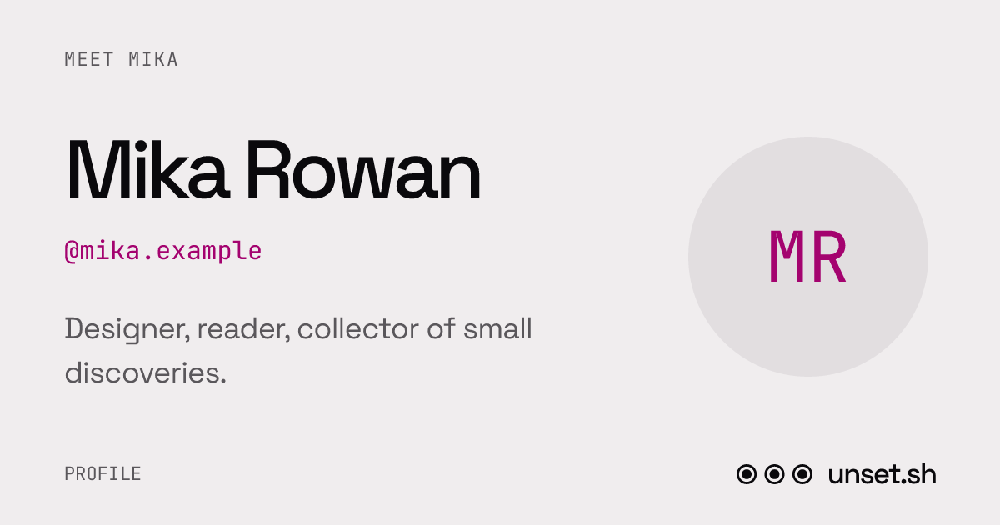
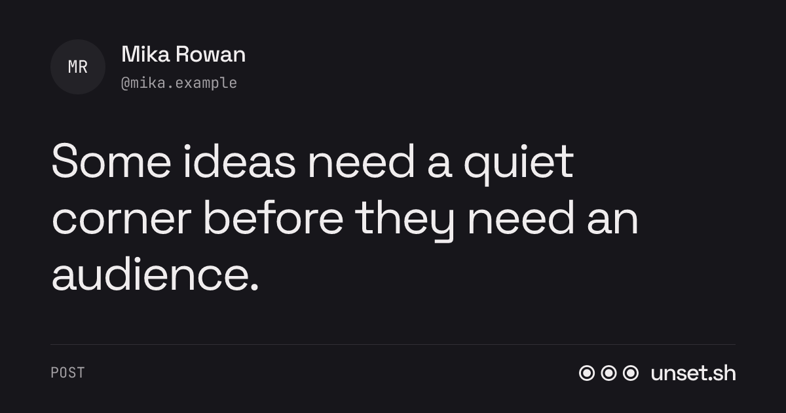
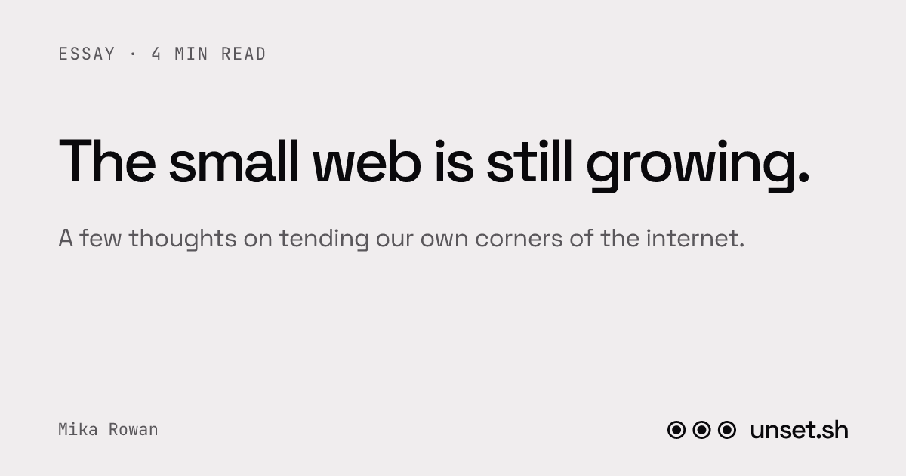
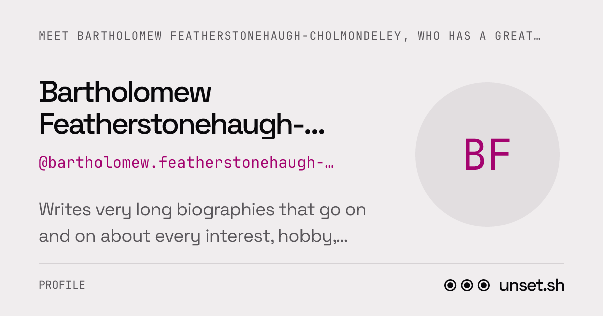

# unset.sh presentation

How [unset.sh](https://unset.sh) looks outside the app. This repository holds the templates and the renderer for
everything Unset shows on other people's screens: today the preview image a link gets when it is shared, later
embeds, share cards and the rest of the list below.

The line it draws is simple: **the app decides what is shown, this toolkit decides how it looks.** The app hands
over plain data it has already decided is public. The toolkit gives back an image. It never fetches, never looks
anything up and has no opinion on who may see what.

It is published as the package `@unset-sh/presentation`. Its colours, fonts and mark come from
[`@unset-sh/brand`](https://github.com/unset-sh/brand) at one exact version, and from nowhere else.

## What belongs here

Anything that is **drawn from supplied data** and **seen outside the app**. One template per surface, one owner
per template, one way of rendering.

| Surface | What it is | State |
| --- | --- | --- |
| Link previews | The 1200 x 630 image shown when a profile, post or article link is shared | Built: `profile`, `post`, `article` |
| Embeds | A profile badge or a post or article shown inside someone else's page, with attribution and a link back | Planned next |
| Share cards | An image a member saves and posts elsewhere, in story, square and wide sizes, usually with a QR code | Planned |
| QR codes and contact cards | A profile as a scannable code or a contact file, for print, events and phones | Planned |
| Video exports and poster frames | The mark, handle and end card on a downloaded clip, and the still shown before a video plays | Planned |
| Email | Invites, notifications and digests as they look in an inbox | Planned |
| Badges and buttons | "Follow me on Unset" for personal sites, badges for READMEs | Planned |

A planned surface gets its folder when its first template is written, not before.

## What does not belong here

| It is | It lives in | Why |
| --- | --- | --- |
| A fixed asset: the logo, icons, fonts, colours, official avatars and banners, press kit, print artwork | [`unset-sh/brand`](https://github.com/unset-sh/brand) | Brand files are copied from the design sheet and never drawn from data |
| A decision about what may be shown, to whom, or for how long | The app | Visibility, blocking, removal and caching need the app's data and its rules |
| An address, a route or a served file: the image URL, the embed endpoint, link-card tags in a page | The app | The toolkit is a library and serves nothing |
| What search engines and feed readers read: page titles, structured data, sitemaps, RSS | The app | It is data, with no look to design |
| Anything that fetches, stores or logs | Nowhere in this repository | See [What it promises](#what-it-promises) |

If a new idea is drawn from data and seen outside the app, it goes here. If it is a file that never changes with
the data, it goes in brand. Everything else stays in the app.

## Use it

Installing from GitHub Packages needs a read-only token; [brand's README](https://github.com/unset-sh/brand#use-it)
has the steps. Then install an exact version:

```sh
npm install --save-exact @unset-sh/presentation
```

```ts
import { renderPreview, version } from "@unset-sh/presentation";

const result = await renderPreview({
  kind: "profile",
  name: "Mika Rowan",
  handle: "mika.example",
  bio: "Designer, reader, collector of small discoveries.",
  picture: { bytes: pictureBytes, mediaType: "image/jpeg" },
});

if (result.ok) {
  // result.png is a 1200 x 630 PNG. Cache it under a hash of the input plus `version`.
} else {
  // result.reason says why. Show the default image.
}
```

The three inputs, in full, are in [`src/contract/types.ts`](src/contract/types.ts):

| Kind | Needs | May also have |
| --- | --- | --- |
| `profile` | `name`, `handle` | `bio`, `picture`, `eyebrow` (the small line above the name) |
| `post` | `author.name`, `author.handle`, `text` | `author.picture` |
| `article` | `author.name`, `title` | `excerpt`, `label` (the small line above the title) |

Every kind takes `lang`, a language tag for the text. `renderPreview(input, { theme })` takes `"dark"` or
`"light"`; left out, each template uses the theme it was designed in (profile and article Light, post Dark).
A handle comes without its at sign.

## What it promises

- **No reach.** No network connection, no environment variable, no clock, no random value, and no file except
  the ones that ship in this package and in `@unset-sh/brand`. A test replaces `fetch` and the console and
  fails if a render touches either.
- **Pictures are bytes.** There is no field that takes an address. A picture must be a JPEG, PNG or WebP file
  that starts like one and decodes.
- **Same input, same image.** Byte for byte, whatever was drawn before it.
- **It never throws.** When no image can be drawn the result names the reason and the field, never the content:

  | Reason | Meaning |
  | --- | --- |
  | `invalid-input` | A field is missing, empty or of the wrong type |
  | `input-too-large` | A text or picture is over a hard limit in `LIMITS` |
  | `picture-unreadable` | The picture is not a JPEG, PNG or WebP file that decodes |
  | `text-not-covered` | The text holds a character no bundled font can draw |
  | `render-failed` | The renderer failed or ran out of time |

- **Fitting is the toolkit's job.** A long name shrinks, then wraps, then is cut with an ellipsis. Other long
  text is cut after its lines. A missing picture becomes the person's initials. A missing bio leaves no gap.
- **Allowing is the app's job.** If a field should not appear, the app leaves it out.
- **Plain text only.** Line breaks, control characters and direction overrides are removed from every field.

## The gallery

[`gallery/cases.ts`](gallery/cases.ts) lists every template against the inputs real data brings: no picture,
the least possible, far too much text, one unbroken word. All of it is invented. Each case's drawing is kept in
[`gallery/expected/`](gallery/expected/), and a test fails when a drawing changes, so a change to a template,
to the brand package or to the renderer shows up in the pull request as changed pictures.

```sh
npm run gallery          # draws every case into gallery/out/, with index.html to look at them
npm run gallery:update   # records the drawings as the new expected ones, on purpose
```

| | |
| --- | --- |
|  |  |
|  |  |

## How it is built

```
src/
├── index.ts            the only public entry: renderPreview, version, the types
├── contract/           what the app can say: types, limits, and the one place input is read and checked
├── templates/          profile, post, article: one file each, plus the frame they share
├── layout/             the small tree a template returns, and the initials for the letter avatar
├── brand.ts            the only file that reads @unset-sh/brand
└── render.ts           the only file that talks to the renderer
```

A template turns checked input and one theme's colours into a tree of boxes, text and images. It knows nothing
about the renderer. [`render.ts`](src/render.ts) draws that tree with [Takumi](https://takumi.kane.tw);
[`docs/renderer-trial.md`](docs/renderer-trial.md) says why Takumi, with the numbers.

`npm run check` runs the type check, the linter, the build and the tests. Among the tests,
[`tests/boundaries.test.ts`](tests/boundaries.test.ts) holds the structure in place: only `render.ts` imports
the renderer, only `brand.ts` reads the brand package, and no colour is written anywhere in the source.

## Add a template

1. Add its input type to `src/contract/types.ts` and read it in `src/contract/parse.ts`, with a limit for every
   text field.
2. Write the template in `src/templates/`, using only `frame.ts`, the tree and the colours it is given.
3. Add its cases to `gallery/cases.ts`: the designed one, the least, the longest.
4. Run `npm run gallery`, look at the drawings, then `npm run gallery:update`.
5. Open a pull request. One template per pull request.

## Releases

A release is a tag `v<version>` on a commit of `main`. The release workflow checks the tag against
`package.json`, runs the checks, packs the package once, and then waits. Alex approves it in GitHub, and only
then is that same packed file signed and published. It refuses to publish while `@unset-sh/brand` is pinned to
a commit instead of a released version.

## Not here yet

- **Text beyond Latin.** The brand fonts cover Latin and Latin Extended-A. A name, bio or post with an emoji or
  with Greek, Cyrillic, Vietnamese, Arabic, Hebrew or East Asian text returns `text-not-covered` today. The
  renderer draws all of these correctly once it is given fonts for them; which scripts to cover, and where those
  fonts live, is an open decision.
- **The brand package from the registry.** `@unset-sh/brand` has no release yet, so it is pinned to a commit of
  its repository. It moves to an exact released version before the first release here.
- **The same bytes on every machine.** Drawings are compared byte for byte on Linux x64, where CI runs. Other
  machines are not checked yet.
- **A truncated picture.** A JPEG cut off part-way still decodes, and is drawn with its missing part grey.
- **A published gallery site, and pushing `docs/` to the docs site.**

## Licence

MIT, see [`LICENSE`](LICENSE). The fonts and the mark it draws with keep the licences of
[`@unset-sh/brand`](https://github.com/unset-sh/brand#licences).
